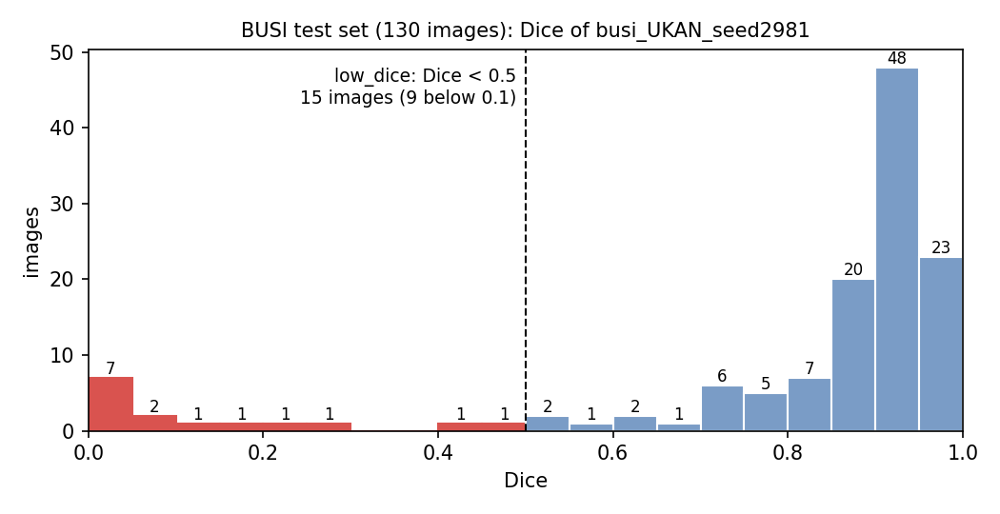

# Ψ-Weighted Expert Models on BUSI（U-KAN）

**把 [psi-weighted-nnunet](https://github.com/OwenWu930302/psi-weighted-nnunet) 的 Ψ 加權專家流程，套用到 BUSI 乳房超音波腫瘤分割與 U-KAN（AAAI 2025）模型。**

Ψ 的定義、proxy 篩選、加權清單規則、加權 loss 公式，全部沿用 psi-weighted-nnunet；
差別在分割模型（U-KAN，而非 nnU-Net）與資料集（BUSI 乳房超音波）。
BTCV、ACDC 的結果請見原倉庫，REFUGE 請見 [psi-weighted-refuge](https://github.com/OwenWu930302/psi-weighted-refuge)。

---

## 流程

```
① baseline（官方 U-KAN，原作者設定：80 / 20 隨機切分、種子 2981、400 epoch）
        │
        ▼
② baseline 預測訓練集 517 張 → 逐張 Dice、Ψ1–Ψ10 → proxy 篩選（低分組 = Dice 最低 30%；不使用測試集）
        │   選出 Ψ1 凸包比、Ψ6 連通元件、Ψ8 旋轉一致性
        ▼
③ 依 Ψ 取最明顯的影像 → 加權清單（Ψ1、Ψ8 各 155 張，Ψ6 33 張）
        │
        ▼
④ 專家模型：清單影像 loss × 3，其餘不變          ⑤ 對照組：同設定、不加權，重新訓練一次
        │                                          │
        └──────────────────┬───────────────────────┘
                           ▼
⑥ 訓練集：被加權影像在「專家 vs 對照組」下的 Dice 變化
⑦ 測試集（20%，130 張）：套用訓練清單的門檻挑出「特徵明顯」的影像，比較專家 vs 對照組
⑧ 搬移實驗：測試集中 Dice < 0.2 的 9 張移到訓練集（權重 1），看它們被看過之後能否學起來
```

$$L = \frac{1}{n}\sum_{i=1}^{n} w_i \cdot L_i, \qquad L_i = 0.5\cdot\mathrm{BCE}_i + (1-\mathrm{Dice}_i), \qquad w_i \in \{1,\ 3\}$$

n 為 batch 張數（8）。U-KAN 官方的 loss（`BCEDiceLoss`）本來就是逐張計算 Dice 再對 batch 取平均，所有影像同為 256×256，
所以權重全為 1 時與官方 loss 完全相同（實測差異 1.2×10⁻⁷，為浮點誤差）。
因此**對照組就是不加權的 baseline**，不需要 nnU-Net 版的 1.0001 倍率。專家模型命名為 `busi_UKAN_psi*w3n`（×3、÷n）。

---

## 與 psi-weighted-nnunet 的差異

| | psi-weighted-nnunet（BTCV / ACDC） | 本倉庫（BUSI） |
|---|---|---|
| 分割模型 | nnU-Net v2.8.1 | [U-KAN](https://github.com/CUHK-AIM-Group/U-KAN)（AAAI 2025）：卷積 + Tokenized KAN 的 U 形網路，約 6.35M 參數 |
| 資料 | 3D 影像的 2D 切片 | 2D 超音波影像，縮放至 256×256 |
| 切分 | BTCV 公開切分、ACDC 官方切分 | 原作者做法：影像名稱排序後 `train_test_split(test_size=0.2, random_state=2981)`，訓練 517 / 測試 130 |
| loss | CE + 整批 Dice | 0.5·BCE + **逐張** Dice（官方實作） |
| 對照組 | 倍率 1.0001（讓 loss 也逐張計算） | 不給清單（權重全為 1），與官方完全相同 |
| proxy 篩選 | 5 折 OOF／測試集（ACDC Ψ1/6/7 †） | baseline 對**訓練集**的預測（同 ACDC 的 all 模式），完全不看測試集 |
| 選用的權重 | 最後一個 epoch | **last**（最後一個 epoch）為主要依據；best（原作者做法：在 20% 集合上挑最好的 epoch）的逐張結果也保留在 `results/percase/` |
| Ψ | 依資料集 | BUSI 只有腫瘤一個結構：可計算 Ψ1、Ψ6、Ψ7、Ψ8；Ψ3/4/5/9/10 需要兩個以上的結構，Ψ2 未定義 |

---

## 主要結果

### 1. baseline 重現

| | IoU | Dice（= 論文的 F1） |
|---|---|---|
| **本研究：best（原作者做法）** | **0.6883** | **0.8056** |
| 本研究：last（最後一個 epoch） | 0.6511 | — |
| 作者 GitHub 單次結果（種子 2981） | 0.6526 | 0.7875 |
| 論文 3 次平均 | 0.6338 ± 0.0283 | 0.7640 ± 0.0290 |

（訓練過程印出的 IoU / Dice 為每個 batch 合併計算後平均，與論文相同；以下分析一律用**逐張** Dice。）

### 2. proxy 篩選（baseline 對訓練集 517 張的預測；低分組 = Dice ≤ 0.9118，155 張）

| Ψ | AUC | p | 規則 | 加權清單 |
|---|---|---|---|---|
| **Ψ1 凸包比** | **0.780** | 6.6×10⁻²⁴ | 前 30%（≥ 1.05127） | 155 張 |
| **Ψ8 旋轉一致性** | **0.705** | 1.3×10⁻¹³ | 前 30%（≥ 0.331525） | 155 張 |
| **Ψ6 連通元件** | 0.537 | 0.0014 | > 0（預測碎成兩塊以上） | 33 張 |
| Ψ7 拓撲環 | 0.497 | 0.13 | 不顯著（實心腫瘤幾乎都等於 1） | — |

### 3. 同設定重訓的雜訊（另一次不加權訓練 − 對照組 base2，`test_BUSI_noise.csv`）

| | 比較 | 訓練集 Δ（逐張標準差） | 測試集 Δ | 逐張標準差 | 升 / 降 | p |
|---|---|---|---|---|---|---|
| best | seed2981 − base2 | −0.0263（0.062），81 / 436 | −0.0093 | 0.099 | 64 / 63 | 0.70 |
| **last** | **base3 − base2** | +0.0007（0.027），240 / 276 | **+0.0094** | **0.103** | 60 / 64 | 0.70 |

- 設定完全相同，只因 best 挑到的 epoch 不同，訓練集就有 436 張下降；**best 的比較主要反映挑到哪個 epoch**，因此以下以 **last** 為主要依據。
- 同設定訓練三次，測試集平均 Dice 就相差約 ±0.01，逐張標準差約 0.10；130 張的平均差異約需超過 0.02，才較能視為超出重訓雜訊。

### 4. 訓練集（last）：被加權的影像本身

| 專家 | 清單 | 對照組 → 專家 | Δ | 升 / 降 | 加權組比未加權組多升 | p |
|---|---|---|---|---|---|---|
| Ψ1 | 155 | 0.9625 → 0.9702 | +0.0077 | 140 / 15 | **+0.0136** | < 0.001 |
| Ψ6 | 33 | 0.9494 → 0.9743 | **+0.0249** | 31 / 2 | **+0.0278** | < 0.001 |
| Ψ8 | 155 | 0.9655 → 0.9703 | +0.0048 | 122 / 33 | **+0.0165** | < 0.001 |

與 ACDC、BTCV 相同：**×3 加權讓清單上的影像本身擬合得更好**（`weighted_cases_BUSI.csv` 為被加權影像逐張，`weighted_cases_BUSI_all.csv` 為全部 517 張）。

### 5. 測試集（last）：Ψ 挑到的影像 vs 真正低分的影像

測試集 130 張的 Dice 是雙峰：大多數 > 0.8，另有 15 張 < 0.5，其中 **9 張 Dice < 0.1（整顆腫瘤找錯位置）**。



- **prominent（特徵明顯）**：Ψ 超過訓練清單的門檻（只用 baseline 的預測，不看標註）
- **low_dice（真正低分）**：baseline（`busi_UKAN_seed2981`）Dice < 0.5，15 張（用標註，僅供分析）。
  用另一個模型而非對照組來定義，避免「用對照組自己的低分挑影像，重訓後自然回升」的偏差。
- **hit** = prominent 且 low_dice；**false_pick** = prominent 但不是 low_dice（原本就不差的影像）；**missed** = low_dice 但不是 prominent
- threshold = 訓練清單中 Ψ 的最小值（即 `proxy_selection_busi.csv` 的 `list_threshold`），記在 `test_BUSI_selection.csv`
- coverage = hit / low_dice；precision = hit / prominent

**(a) Ψ 挑了幾張、挑到幾張低分**（`test_BUSI_selection.csv`）

| 專家 | threshold | n_prominent | n_low_dice | n_hit | n_false_pick | n_missed | coverage | precision |
|---|---|---|---|---|---|---|---|---|
| Ψ1 | ≥ 1.05127 | 48 | 15 | 12 | 36 | 3 | 12/15 = 0.80 | 12/48 = 0.25 |
| Ψ6 | > 0 | 21 | 15 | 8 | 13 | 7 | 8/15 = 0.53 | 8/21 = 0.38 |
| Ψ8 | ≥ 0.331525 | 38 | 15 | 14 | 24 | 1 | **14/15 = 0.93** | 14/38 = 0.37 |

**(b) 對照組 → 專家，各組的 Δ（n_up / n_down）**（`test_BUSI_summary.csv`，last）

| 專家 | all（130） | prominent | low_dice（15） | false_pick |
|---|---|---|---|---|
| Ψ1 | +0.0072（61 / 64） | +0.0232（23 / 21） | +0.0275（7 / 3） | +0.0228（18 / 18） |
| Ψ6 | +0.0147（67 / 57） | **+0.0435（14 / 4）** | +0.0057（5 / 4） | **+0.0676（11 / 2）** |
| Ψ8 | **+0.0222（69 / 56）** | +0.0343（19 / 14） | +0.0233（7 / 3） | +0.0413（13 / 11） |

Wilcoxon p：Ψ8 all = 0.027；Ψ6 prominent = 0.094、false_pick = 0.068；其餘 > 0.09。

- 三個專家的整個測試集都高於對照組（+0.007 至 +0.022），Ψ8 達顯著。
- 三個專家的特徵明顯組都比其他影像進步更多（prominent +0.023 至 +0.044，比 all 多 +0.012 至 +0.029），方向符合預期，但都未達顯著。
- **對照組 base2 的 last 偏低**：第三次不加權訓練（base3）的 last 比 base2 高 +0.0094。改以 base3 為對照，三個專家的整體變化為
  Ψ1 −0.0022（p = 0.47）、Ψ6 +0.0053（p = 0.60）、**Ψ8 +0.0128（p = 0.17）**，皆不顯著。上表相對 base2 的提升有一部分來自對照組偏低。

### 6. 搬移實驗：測試集最差的影像被看過之後能否學起來

兩個 baseline（`seed2981` best、`base2` last）在測試集都 Dice < 0.2 的 9 張（`weight_lists/moved_busi_dice02.csv`）移到訓練集，
其餘設定與對照組相同（權重 1），訓練 526 張、測試 121 張（`moved_BUSI_*.csv`）。

| 組別 | n | 對照組 | 搬移後 | Δ | 升 / 降 | p |
|---|---|---|---|---|---|---|
| **moved（測試集 → 訓練集）** | 9 | 0.0026 | **0.9622** | +0.9595 | 9 / 0 | 0.004 |
| remaining_test | 121 | 0.8398 | 0.8373 | −0.0025 | 55 / 66 | 0.69 |
| original_train | 517 | 0.9659 | 0.9675 | +0.0016 | 264 / 253 | 0.17 |

- 9 張原本 Dice ≈ 0 的影像，被看過之後全部達 0.92 至 0.99，與一般訓練影像（0.97）相當：**這些影像與標註本身沒有問題，是可以學的**；
  在測試集失敗是因為訓練集中沒有相似的例子（泛化問題），而不是影像模糊或標註錯誤。
- 多學這 9 張，對其餘 121 張測試影像沒有幫助（−0.0025，不顯著）。

### 7. 權重倍率：×3、×10、×20（`weight_factor_BUSI.csv`）

與 ×3 相同的流程、清單與官方切分，只把清單影像的權重改為 10、20（loss 仍 ÷ n）。Δ 為專家 − 對照組。

| Ψ | 倍率 | 訓練集：加權比未加權多升 | 測試集 Dice | vs base2 | vs base3（p） | prominent Δ | low_dice Δ | false_pick Δ |
|---|---|---|---|---|---|---|---|---|
| Ψ1 | ×3 | +0.0136 | 0.7890 | +0.0072 | −0.0022（0.47） | +0.0232 | +0.0275 | +0.0228 |
| | ×10 | +0.0408 | 0.7689 | −0.0129 | **−0.0223（< 0.001）** | +0.0124 | +0.0025 | +0.0152 |
| | ×20 | +0.0583 | 0.7581 | −0.0237 | **−0.0331（< 0.001）** | −0.0144 | −0.0309 | −0.0041 |
| Ψ6 | ×3 | +0.0278 | 0.7965 | +0.0147 | +0.0053（0.60） | +0.0435 | +0.0057 | +0.0676 |
| | ×10 | +0.0277 | 0.7870 | +0.0052 | −0.0042（0.83） | +0.0282 | +0.0223 | +0.0207 |
| | ×20 | +0.0463 | 0.7818 | −0.0001 | −0.0095（0.14） | +0.0462 | +0.0476 | +0.0396 |
| Ψ8 | ×3 | +0.0165 | **0.8040** | +0.0222 | +0.0128（0.17） | +0.0343 | +0.0233 | +0.0413 |
| | ×10 | +0.0392 | 0.7652 | −0.0166 | **−0.0260（0.006）** | −0.0055 | −0.0265 | +0.0155 |
| | ×20 | +0.0556 | 0.7492 | −0.0327 | **−0.0421（< 0.001）** | −0.0230 | −0.0059 | −0.0333 |

prominent、low_dice、false_pick 的 Δ 以 base2 為對照。對照組測試集 Dice：base2 0.7818、base3 0.7912。

- **權重越大，清單影像在訓練集上學得越好**（加權比未加權多升：Ψ1 +0.014 → +0.041 → +0.058；Ψ8 +0.017 → +0.039 → +0.056）。
- **但 Ψ1、Ψ8 的測試集在 ×10、×20 顯著變差**：兩份清單各 155 張（訓練集 30%），×20 時清單影像約佔 loss 的 90%，模型幾乎只學清單影像。
- Ψ6 清單只有 33 張（×20 時約佔 loss 的 58%），整體沒有顯著變化。
- **×3 是三個倍率中唯一沒有傷害、且方向偏正的設定。**

### 結論

> Ψ 能在沒有標註的情況下挑出困難的影像（訓練集篩選 AUC 0.78 / 0.71；測試集真正低分影像的覆蓋率 Ψ8 93%、Ψ1 80%），
> ×3 加權讓訓練集上被加權的影像變好（三個專家皆顯著）。測試集上三個專家都高於對照組 base2（Ψ8 +0.022，p = 0.027），
> 但第三次不加權訓練（base3）顯示 base2 的 last 偏低約 0.009；改以 base3 為對照，最好的 Ψ8 為 +0.013（p = 0.17），在重訓雜訊範圍內。
> 權重加大到 ×10、×20 會讓清單影像在訓練集上學得更好，但 Ψ1、Ψ8 的測試集顯著變差（−0.022 至 −0.042），×3 是三個倍率中最好的。
> 測試集最差的 9 張（位置找錯）被看過之後可以完全學起來，代表它們的失敗來自訓練集缺少相似的例子；
> 加權只能改變已有訓練影像的比重，無法補上沒有的例子。
>
> 另外，原作者「在 20% 集合上挑最好 epoch 並報告同一集合」的做法會引入很大的雜訊（第 3 節），比較加權效果時應以固定的 epoch 為準。

---

## 重現

需要 NVIDIA GPU（本研究使用 RTX 4080）。第 1 步之後全部在 `U-KAN/Seg_UKAN` 資料夾執行。`setup_ukan.sh` 預設把資料夾放在 `/mnt/data2t/BUSI`、桌面 `~/桌面/BUSI` 為捷徑，可用 `DATA=… LINK=… bash setup_ukan.sh` 改位置。

```bash
# 1. 環境與官方程式（建立 conda 環境 ukan、下載 U-KAN、修正官方程式無法執行的兩處、改寫 requirements）
bash ukan_extension/setup_ukan.sh

# 2. 資料：Kaggle「Breast Ultrasound Images Dataset」（U-KAN README 所附連結）
#    官方 pre-processed 連結已失效，改由原始資料整理：只用 benign + malignant（647 張），多個遮罩取聯集
python prep_busi.py <Dataset_BUSI_with_GT> inputs/busi

# 3. baseline（原作者指令）
python train.py --arch UKAN --dataset busi --input_w 256 --input_h 256 --name busi_UKAN_seed2981 --data_dir ./inputs

# 4. 加入 Ψ 加權與 --move_to_train（不給 --wcases、--move_to_train 時與原版完全相同）
python patch_ukan_weighted.py

# 5. baseline 預測 + Ψ、篩選並產生清單
python predict_busi.py --name busi_UKAN_seed2981 --which best --psi
python screen_busi.py outputs/busi_UKAN_seed2981/percase_best.csv <清單資料夾>

# 6. 其餘全部一次完成：對照組 → 三個 w3n 專家 → 分析 → 搬移清單 → 搬移後訓練 → 分析（可中斷後重跑）
LISTS=<清單資料夾> nohup bash run_busi_all.sh > run_busi_all.log 2>&1 &

# 7. 追加實驗：base3（第三次不加權訓練）→ ×10、×20 專家 → 各倍率分析與總表（可中斷後重跑）
LISTS=<清單資料夾> nohup bash run_busi_more.sh > run_busi_more.log 2>&1 &
```

`ukan_extension/` 的檔案複製到 `U-KAN/Seg_UKAN` 後使用（`setup_ukan.sh` 除外）。`predict_busi.py` 的 Ψ 計算沿用
psi-weighted-nnunet 的 `psi/run_all_psi.py`（以 `--psi_lib` 指定路徑）。

### 官方程式的修正（`setup_ukan.sh`）

| 問題 | 現象 | 修正 |
|---|---|---|
| `train.py` 讀取 `archs.__all__`，`archs.py` 未定義 | 一執行就 `AttributeError` | `archs.py` 第一行加 `__all__ = ['UKAN']` |
| `metrics.py` 需要 `medpy`，requirements 未列 | `ImportError` | 加入 |
| `scipy==1.5.4`、`scikit-image==0.17.2` | 作者指定的 Python 3.10 沒有對應版本，無法安裝 | 移除固定版本（程式未直接使用） |
| `timm==0.3.2` | 使用 `torch._six`，與作者指定的 PyTorch 1.13 不相容 | `timm==0.4.12` |
| numpy / opencv / albumentations 未固定版本 | 會裝到與 PyTorch 1.13 或程式不相容的新版 | 固定版本（見 `ukan_extension/requirements_ukan.txt`） |

---

## 檔案

| 位置 | 內容 |
|---|---|
| `ukan_extension/patch_ukan_weighted.py` | 在官方 `train.py`、`losses.py` 加入 Ψ 加權（`--wcases`、`--wfactor`，loss ÷ n）、`--move_to_train` 與每個 epoch 存 `model_last.pth`；修改處皆標 `[Ψ加權]` |
| `ukan_extension/ukan_patch.diff` | 修改後與官方原檔的完整差異 |
| `ukan_extension/predict_busi.py` | 預測訓練集與測試集、逐張 Dice、Ψ1–Ψ10（Ψ8 含旋轉推論）；切分與官方 `train.py` 相同 |
| `ukan_extension/screen_busi.py` | proxy 篩選與加權清單（規則同 psi-weighted-nnunet） |
| `ukan_extension/run_busi_all.sh` | 第 6 步的全部流程 |
| `ukan_extension/run_busi_more.sh` | 第 7 步：base3、×10、×20 專家與倍率總表 |
| `ukan_extension/train_busi_queue.sh` | 依序訓練對照組與專家，訓練完立即預測（best、last） |
| `ukan_extension/analyze_busi.py` | 訓練集加權前後；測試集的挑選張數、coverage / precision、各組前後變化、重訓雜訊 |
| `ukan_extension/moved_busi.py` | 搬移實驗：產生清單（`make`）與分析（`analyze`） |
| `ukan_extension/prep_busi.py`、`setup_ukan.sh`、`requirements_ukan.txt` | 資料整理、環境建置、改寫後的套件版本 |
| `weight_lists/` | 三個加權清單（影像名稱、Ψ 值、baseline Dice）；`moved_busi_dice02.csv` 為搬移實驗移到訓練集的 9 張 |
| `results/psi_selection/proxy_selection_busi.csv` | proxy 篩選結果 |
| `results/percase/` | 每個模型逐張的 Dice（`<模型>_<best或last>.csv`）；`busi_UKAN_seed2981_best.csv` 含十個 Ψ |
| `results/analysis/` | 皆為 last。`weighted_cases_BUSI`（被加權影像）、`_all`（全部 517 張）、`_summary`、`_compare`（訓練集）；`test_BUSI_selection`（門檻、挑選張數、coverage、precision）、`test_BUSI_summary`（各組 control → expert）、`test_BUSI_percase`（逐張）、`test_BUSI_noise`（重訓雜訊：seed2981 best、base3 last）、`test_BUSI_dice_hist.png`（測試集 Dice 分布）；`moved_BUSI_*`（搬移實驗）；`weight_factor_BUSI.csv`（×3、×10、×20 總表） |
| `results/training_logs/` | 每個模型每個 epoch 的 loss 與 IoU |

資料、影像與模型權重不包含在倉庫中。U-KAN 的程式不包含在本倉庫，見 [THIRD_PARTY_NOTICES.md](THIRD_PARTY_NOTICES.md)。

## 參考

- Li et al., *U-KAN Makes Strong Backbone for Medical Image Segmentation and Generation*, AAAI 2025. [論文](https://arxiv.org/abs/2406.02918)／[程式](https://github.com/CUHK-AIM-Group/U-KAN)
- Al-Dhabyani et al., *Dataset of breast ultrasound images*, Data in Brief, 2020.（BUSI）